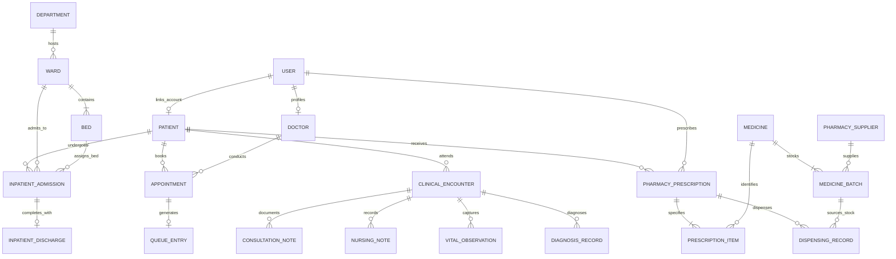

# Gondar Hospital Management System (GHMS)
## Entity-Relationship Architecture & Data Dictionary

This document details the normalized relational database design for GHMS implemented in MySQL using Prisma ORM.

---

## 1. Domain Entities & Relationship Overview

The database contains **85 relational tables** organized into core hospital operational domains:

---

## 2. Core Operational Subsystems

### 2.1 Identity, Users & Governance
- **`User` (Base Staff & Patient Accounts):**
  - Primary Key: `id` (UUID CHAR(36))
  - Unique: `email`, `username`, `phone`
  - Attributes: `passwordHash`, `role` (`ADMINISTRATOR`, `DOCTOR`, `NURSE`, `PHARMACIST`, `LABORATORY_TECHNICIAN`, `RECEPTIONIST`, `FINANCE_OFFICER`, `PATIENT`, etc.), `status` (`ACTIVE`, `PENDING`, `DISABLED`), `firstName`, `middleName`, `lastName`, `department`.
  - Relations: 1:1 with `Patient`, 1:1 with `Doctor`, 1:N with `RefreshSession`, 1:N with `AuditLog`.
- **`Department`:**
  - Unique: `code`, `name`.
  - Relations: 1:N with `Ward`.
- **`SystemPermission` & `RolePermission`:**
  - Granular RBAC linking system actions (`module`, `action`) to user roles.

### 2.2 Patient Care & Inpatient Operations
- **`Patient`:**
  - Primary Key: `id` (UUID CHAR(36))
  - Unique: `patientNumber` (e.g. `GHMS-000001`)
  - Attributes: Demographic details, Ethiopian region/zone/woreda/kebele, blood group, allergies, chronic medical conditions, emergency contacts, insurance references.
- **`Ward`:**
  - Unique: `code` (e.g. `WARD-MED`, `WARD-SURG`)
  - Attributes: `name`, `type` (`INTERNAL_MEDICINE`, `SURGERY`, `PEDIATRICS`, `GYNECOLOGY_OBSTETRICS`, `ICU`, etc.), `capacity`.
  - Relations: Many-to-One with `Department`, One-to-Many with `Bed`, One-to-Many with `InpatientAdmission`.
- **`Bed`:**
  - Unique: Composite `[wardId, bedNumber]` (e.g. `MED-01` within `WARD-MED`).
  - Attributes: `status` (`AVAILABLE`, `OCCUPIED`, `RESERVED`, `CLEANING`, `MAINTENANCE`), `currentPatientId`.
  - Deletion Rule: `onDelete: Restrict` on `wardId` ensures a ward with configured beds cannot be inadvertently purged.
- **`InpatientAdmission`:**
  - Unique: `admissionNumber` (e.g. `ADM-6001`).
  - Foreign Keys: `patientId` (Restrict), `wardId` (Restrict), `bedId` (SetNull), `doctorId` (SetNull).
  - Attributes: `reason`, `status` (`PENDING`, `ADMITTED`, `DISCHARGED`, `TRANSFERRED`), `admittedAt`, `dischargedAt`.
- **`InpatientDischarge`:**
  - Unique: `dischargeNumber`, `admissionId` (1:1 with `InpatientAdmission`).
  - Attributes: `finalDiagnosis`, `medicationInstructions`, `followUpInstructions`, `authorizationStatus` (`PENDING_AUTHORIZATION`, `AUTHORIZED`), `authorizedAt`.

### 2.3 Pharmacy, Prescriptions & Dispensing
- **`Medicine`:**
  - Unique: `code` (e.g. `MED-001`).
  - Attributes: `genericName`, `brandName`, `category`, `strength`, `dosageForm` (`TABLET`, `CAPSULE`, `SYRUP`, `INJECTION`, `INHALER`, etc.), `unit`, `price` (DECIMAL(10, 2)), `reorderLevel`.
  - Indexes: Index on `genericName`, composite index on `[category, active]`.
- **`MedicineBatch`:**
  - Unique: `batchNumber` (e.g. `PAR-26-01`).
  - Attributes: `quantity`, `purchaseDate`, `expiryDate`, `storageLocation`.
  - Foreign Keys: `medicineId` (Restrict), `supplierId` (SetNull).
  - Indexes: Index on `expiryDate`, composite on `[medicineId, expiryDate]`.
- **`PharmacySupplier`:**
  - Unique: `supplierCode` (e.g. `SUP-010`).
  - Attributes: `name`, `contactName`, `phone`, `email`, `address`, `status`.
- **`PharmacyPrescription`:**
  - Unique: `prescriptionNumber` (e.g. `RX-8101`).
  - Foreign Keys: `patientId` (Restrict), `doctorId` (SetNull), `encounterId` (SetNull).
  - Attributes: `doctorName`, `dispensingStatus` (`PENDING`, `PARTIAL`, `DISPENSED`, `CANCELLED`), `issuedAt`.
  - Relations: One-to-Many `PharmacyPrescriptionItem` (`onDelete: Cascade`), One-to-Many `DispensingRecord`.
- **`PharmacyPrescriptionItem`:**
  - Attributes: `dosage`, `frequency`, `duration`, `instructions`, `quantity`, `dispensedQuantity`.
- **`DispensingRecord`:**
  - Unique: `receiptNumber` (e.g. `RCP-9001`).
  - Foreign Keys: `prescriptionId` (Restrict), `patientId` (Restrict), `medicineId` (Restrict), `batchId` (SetNull), `dispensedById` (Restrict).
  - Attributes: `batchNumber`, `quantity`, `dispensedAt`.

### 2.4 Diagnostics, Blood Bank & Radiology
- **`LaboratoryOrder` & `LaboratoryResult`:**
  - Structured ordering of test catalog items (`LaboratoryTestCatalogItem`), biological specimens (`LaboratorySpecimen`), verified results, and immutable audit amendments (`LaboratoryResultAmendment`).
- **`RadiologyRequest` & `ImagingReport`:**
  - Diagnostic imaging workflow covering modality (X-Ray, Ultrasound, CT, MRI), clinical indication, radiological findings, and release approvals.
- **`DiagnosticAttachment`:**
  - Medical images, DICOM studies, scan attachments, and PDFs linked to patient charts with strict access controls.
- **`BloodBankUnit` & `TransfusionRecord`:**
  - Complete vein-to-vein blood management: donor screening (`BloodDonor`), donation collection (`BloodDonation`), unit quarantine/testing (`BloodBankUnit`), crossmatching (`BloodCrossmatch`), and direct clinical transfusion administration (`TransfusionRecord`).

### 2.5 Facilities, Fleet & Equipment Assets
- **`OperatingRoom`:** Room scheduling, procedure tracking, surgical team allocation.
- **`Ambulance`, `AmbulanceTrip`, `AmbulanceMaintenance`:** Fleet availability, emergency inter-hospital patient dispatching, and scheduled vehicle servicing.
- **`GeneralInventoryItem`:** Hospital consumables (gloves, masks, syringes, cannula) with storage locations and reorder alarms.
- **`HospitalAsset` & `AssetMaintenanceRequest`:** Biomedical equipment asset tracking with serial numbers, operating conditions, and maintenance tickets.

---

## 3. Data Integrity & Constraint Matrix

| Subsystem | Foreign Key Restrict Rules | Unique Keys | Precision Types |
| :--- | :--- | :--- | :--- |
| **Authentication** | User -> RefreshSession (Cascade) | `email`, `username`, `phone`, `tokenHash` | UUID Char(36) |
| **Inpatient** | Ward -> Bed (Restrict) | `wardId + bedNumber` | UUID Char(36) |
| **Admissions** | Patient -> Admission (Restrict) | `admissionNumber`, `dischargeNumber` | Dates & Timestamps |
| **Pharmacy** | Medicine -> Batch (Restrict) | `code`, `batchNumber`, `receiptNumber` | `Decimal(10, 2)` for price |
| **Prescriptions**| Prescription -> Item (Cascade) | `prescriptionNumber` | Integer quantities |
| **Billing** | Invoice -> Item (Cascade) | `invoiceNumber`, `receiptNumber` | `Decimal(12, 2)` for amounts |
| **Blood Bank** | Donor -> Donation (Restrict) | `donorNumber`, `unitNumber`, `recordNumber` | Strict Enums |
| **Equipment** | Asset -> Maintenance (Restrict) | `assetTag`, `serialNumber`, `ticketNumber` | Char(36) UUIDs |
